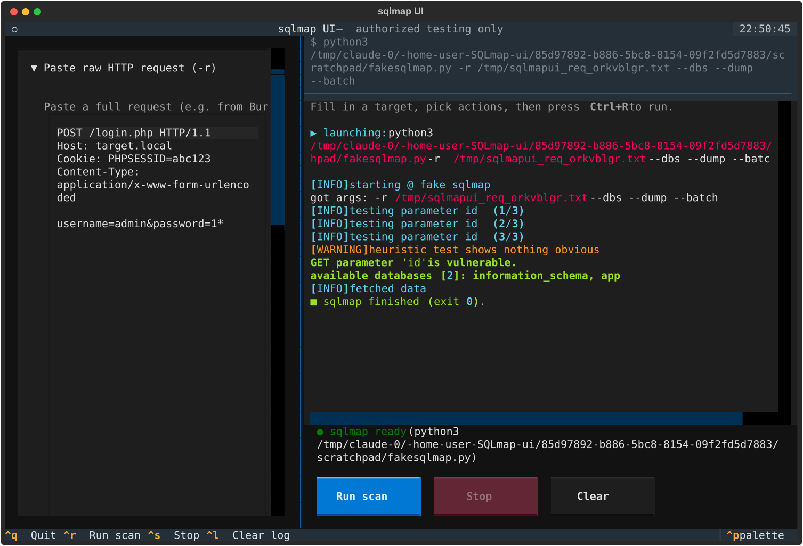

# sqlmap UI

A keyboard-friendly **terminal UI** for a locally installed
[sqlmap](https://sqlmap.org/). It builds sqlmap command lines from a simple
form, runs sqlmap for you, and streams its live, colorized output — no browser,
no web server. Runs in any terminal (or as a standalone `.exe`).

**Features**
- One-click **scan presets** (Quick / Standard / Enum / Full)
- **Never deletes data** — blocks destructive SQL and OS/SQL shells
- **Edit the full command** by hand before running — total control
- **Auto-answer (`--batch`) or manual** — answer sqlmap's prompts yourself
- **Live command preview** — see the exact sqlmap command as you change options
- Paste a **raw HTTP request** (Burp/ZAP) or load it from a file (`-r`)
- **Clipboard paste & copy** that work even where terminal `Ctrl+V` doesn't
- **Save output** to a timestamped log file
- **Remembers your settings** between runs
- Full **`sqlmap -hh`** option list on tap (any flag usable via *Extra options*)

> ⚠️ **For authorized security testing only.** Only run sqlmap against systems
> you own or have explicit written permission to test.



## Requirements

- Python 3.9+
- [sqlmap](https://github.com/sqlmapproject/sqlmap) installed (you already have it)
- `textual` (the only Python dependency)

## Install & run (Windows)

```cmd
pip install -r requirements.txt
python sqlmap_ui.py
```

Or just double-click / run **`run.bat`**, which installs the dependency on first
launch and starts the UI.

If `sqlmap` is on your `PATH`, the UI finds it automatically. Otherwise point it
at your install with the `SQLMAP_PATH` environment variable:

```cmd
:: if you installed sqlmap from source (sqlmap.py)
set SQLMAP_PATH=python C:\tools\sqlmap\sqlmap.py
python sqlmap_ui.py

:: if you installed sqlmap via pip (sqlmap.exe on PATH) nothing extra is needed
```

> Tip: run it in **Windows Terminal** or PowerShell for the best colors; the
> classic `cmd.exe` console works too.

### Linux / macOS

```bash
pip install -r requirements.txt
python3 sqlmap_ui.py          # or: ./run.sh
SQLMAP_PATH="python /opt/sqlmap/sqlmap.py" python3 sqlmap_ui.py
```

## Using it

1. Enter the **target URL** (e.g. `http://host/page.php?id=1`) **— or** expand
   **"Paste raw HTTP request (-r)"** and paste a full request copied from Burp,
   ZAP, or your browser's dev tools. When a request is pasted it takes
   precedence over the URL field; mark the injection point with `*` if you want
   to target a specific parameter.
2. Click a **preset** (Quick / Standard / Enum / Full) to set sensible options,
   or tick the **actions** you want and set level/risk/DBMS yourself.
3. Watch the **command preview** at the top of the output pane update live.
4. Press **Ctrl+R** (or click **▶ Run**). Output streams on the right; the
   status bar shows a running timer and the final exit code.

### Never deletes data

The tool refuses to run any command — from the form **or** the editable command
box — that could **delete or destroy data**. Blocked actions:

- `--os-shell`, `--os-cmd`, `--os-pwn`, `--sql-shell` (arbitrary execution)
- a `--sql-query` containing `DROP`, `DELETE`, `TRUNCATE`, `ALTER`, or
  `UPDATE … SET`

Reading data is allowed: the presets enumerate structure and can read password
hashes (for cracking), and `--dump` remains available as a manual checkbox.
sqlmap never deletes data on its own; this guard stops you from supplying a
statement that would.

### Answering prompts: auto vs. manual

By default **Auto-answer prompts (`--batch`)** is on, so sqlmap takes its
default answer to every question and never blocks. **Uncheck it** to answer
yourself: when sqlmap asks something, the question appears above an answer box
at the bottom of the output — type your reply and press **Enter** (just Enter
accepts sqlmap's default). In the editable-command mode, simply include or omit
`--batch` to choose. The setting is remembered between runs.

### Full manual control — edit the command

Click **✏ Edit command** (bottom bar) to turn the command preview into an
editable box. Whatever you type there is run **exactly as-is** when you press
**Ctrl+R**, so you can add, remove, or rewrite any flag the form doesn't expose.
Click **✖ Use form** to switch back to building from the form. (If you'd pasted
a raw request, the placeholder `<pasted-request.txt>` in the command is swapped
for the real temp file at run time.)

Your inputs are remembered between runs (stored in `~/.sqlmap_ui.json`). The
pasted request is saved to a temporary file (with the CRLF line endings sqlmap
expects), passed as `-r`, and deleted automatically when the scan ends.

**Paste not working?** Terminal paste is finicky — especially in the legacy
`cmd.exe` console, which doesn't always hand pasted text to the app. Two
reliable fixes:

- **Press `Ctrl+B` to paste into whatever field your cursor is in** — Target
  URL, Cookie, Proxy, the request box, any of them. It reads your clipboard
  directly (via PowerShell on Windows), so it works no matter how your terminal
  handles `Ctrl+V`. (The 📋 button next to the request box pastes into that box.)
- Or save a request to a `.txt` file and use the **"…or load the request from a
  saved file"** field.

Running in **Windows Terminal** (not `cmd.exe`) also makes normal `Ctrl+V` /
right-click paste work.

## All sqlmap options

The form covers the common actions, but **any** sqlmap flag works — type it into
the **Extra raw options** box (e.g. `--tamper=space2comment --technique=BEUST
--flush-session`). Press **F1** (or the **sqlmap options** button) to print
sqlmap's complete option list (`sqlmap -hh`) into the output pane for reference.

Output streams in the right-hand pane as sqlmap runs. The exact command is shown
above the log so you can see — and learn — the flags being used.

### Keyboard shortcuts

| Key      | Action                          |
|----------|---------------------------------|
| `Ctrl+R` | Run scan                        |
| `Ctrl+S` | Stop scan                       |
| `Ctrl+B` | Paste clipboard into focused field |
| `Ctrl+E` | Copy output to clipboard        |
| `Ctrl+O` | Save output to a file           |
| `Ctrl+L` | Clear log                       |
| `F1`     | Show all sqlmap options (`-hh`) |
| `Ctrl+Q` | Quit                            |

Anything the form doesn't cover can be typed into **Extra raw options** (e.g.
`--tamper=space2comment --random-agent`); it's passed straight to sqlmap.
`--batch` is always added so sqlmap never blocks waiting for input.

## Build a standalone .exe (Windows)

No Python needed on the target machine:

```cmd
pip install pyinstaller
pyinstaller --onefile --name sqlmap-ui sqlmap_ui.py
```

The binary lands in `dist/`. (sqlmap itself still needs to be installed; set
`SQLMAP_PATH` if it isn't on `PATH`.) The same command works on Linux/macOS to
produce a single-file binary.

## Notes on safety

- sqlmap is launched directly as a subprocess — **no shell is ever invoked**, so
  form values can't be used for shell injection.
- Stopping a scan terminates the whole sqlmap process group.
